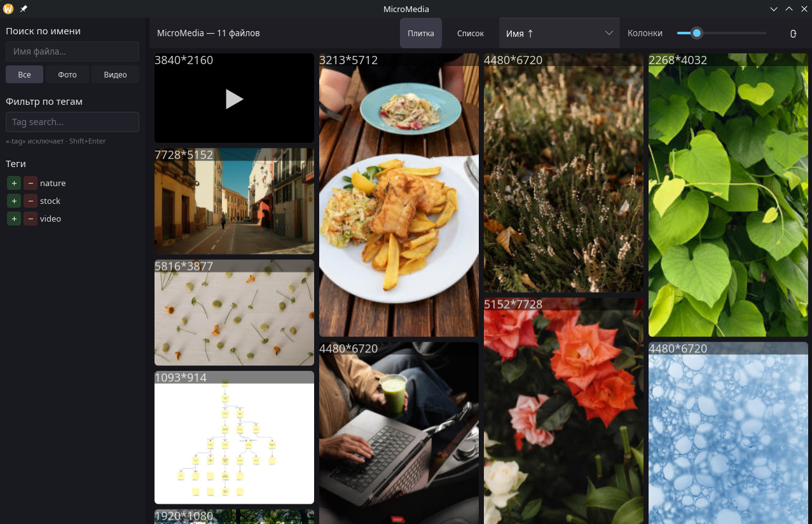
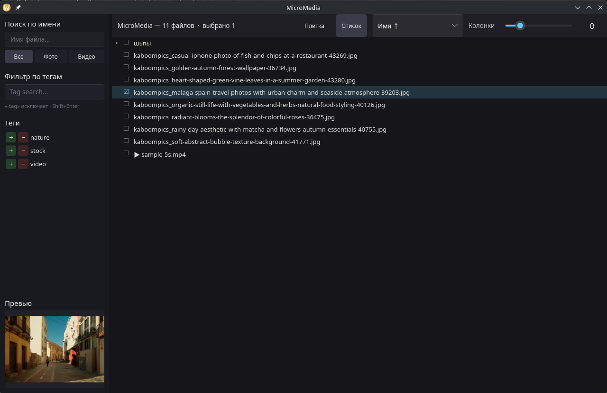
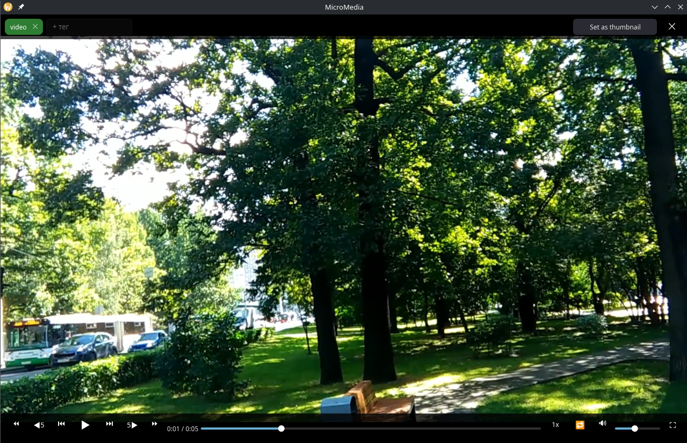
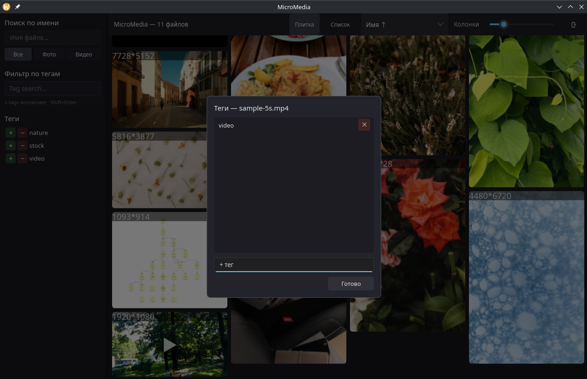

# MicroMedia

*[Читать на русском](README_RU.md)*

Portable desktop viewer for video and images.

**Download:** https://github.com/AzimovIz/micromedia/releases/latest
(Windows x86_64 and Linux x86_64).

> Video playback requires **libmpv**. If mpv is installed on the system, it
> will be used automatically. Otherwise, place `libmpv.so` (Linux) /
> `libmpv-2.dll` (Windows) in `appdata/libs/` next to the binary (the archive
> includes a hint file).


> **If the app is empty** - put your media files into the `media` folder
> next to the binary and click the rescan button in the top-right corner.

---

## Screenshots

| Library | List |
|---|---|
|  |  |

| Player | Tags |
|---|---|
|  |  |

---

## Features

### Library
- Scans the `media/` folder and indexes it in the background (SQLite).
- Tile gallery with thumbnails; slider for the number of columns.
- **"List"** view — a tree-like folder structure, like in a file explorer.
- "Refresh" button — reindexing: scan → thumbnails → hash → duration.
  Progress is visible in the log (`RUST_LOG=info`, default level).
- File renames and moves are detected: the record moves to the new path,
  keeping tags, playback position, and thumbnail.
- Background preview generation (images — natively, video — a frame via mpv).

### Viewer
- Overlay lightbox on top of the gallery for photos and videos.
- **Mouse-wheel zoom**, pan with left click, reset with middle click (photos
  and videos).
- Animated **GIFs** (played via mpv, with looping).

### Video player
- Play/pause, seeking, ±5/±10 s skips, frame-by-frame step.
- Speed 0.5–2×, loop, volume, mute, `m:ss` time display.
- Fullscreen mode with auto-hiding controls (appear on mouse movement).
- RAM demux cache — smooth playback even from a slow flash drive.
- **Set as thumbnail** — make the current frame the file's thumbnail.
- **Fragments** — mark a start/end range on the timeline and name it; it's
  highlighted on the seek bar (hover for the name), click to jump to its
  start, right-click to edit or delete.
- Keys: `Space` — pause, `←/→` — ±5 s, `F` — fullscreen, `Esc` — exit.

### Organization and search
- **Tags**: assign/remove, autocomplete, bulk tagging for a selection.
  Orphaned tags (with no files) are removed automatically.
- **Tag filter** - string like `tag1 -tag2` (minus excludes).
- Alphabetical tag list with `+` / `−` buttons (include / exclude).
- **Search by file name** and **filter by type** (photo / video).
- **Sorting**: name, date added, file date, size, type, duration.

### List and bulk operations
- Multi-select via checkboxes; selecting a folder cascades to its nested
  files.
- Right-click on a selected item: add/remove tags, delete from disk (with
  confirmation).
- Right-click on an unselected item: "Open location" in the system file
  manager.

### Other
- State persistence (`appdata/config.toml`): sorting, tag search, video
  volume.
- Adjustable sidebar width (draggable border).

---

## Data layout

```text
micromedia            # micromedia / micromedia.exe
media/                # your media files (indexed from here)
appdata/
  micromedia.db       # SQLite: files, tags, metadata
  thumbnails/         # thumbnail cache
  libs/               # libmpv.so / libmpv-2.dll (if no system mpv)
  config.toml         # saved settings
```

Put your files into `media/` and click "Refresh" (or restart the app).

---

## Build

Rust + [cargo-zigbuild](https://github.com/rust-cross/cargo-zigbuild) (for
portable glibc 2.17). On Linux you need `libfontconfig-dev`.

```sh
# Linux (glibc 2.17)
cargo zigbuild --release --target x86_64-unknown-linux-gnu.2.17
# Windows
cargo zigbuild --release --target x86_64-pc-windows-gnu
```

---

## Tech stack

Rust · [Slint](https://slint.dev) (GL/femtovg) · [mpv](https://mpv.io) · SQLite (rusqlite).


## Built with Claude
This project was almost entirely written by Claude (Anthropic's AI assistant) using Claude Code, with a human developer setting direction, testing, and giving feedback. Everything — from architecture to implementation (Rust code, UI, libmpv integration, SQLite database schema, background scanning) — was created by Claude.
